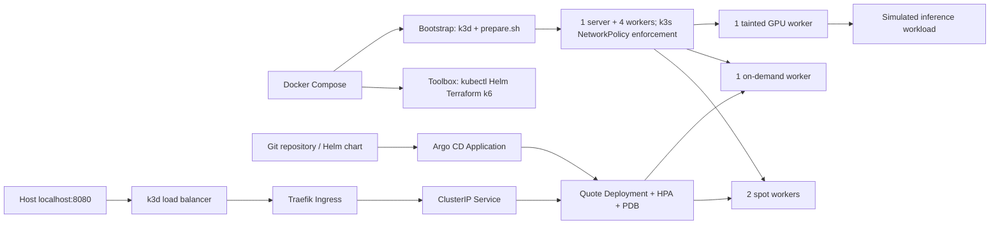
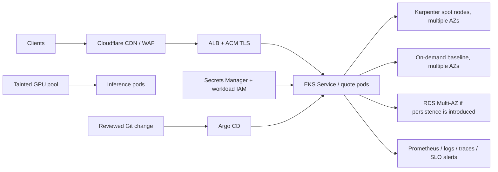

# ELSA DevOps challenge

[](https://github.com/sonqn/elsa/actions/workflows/ci.yml)

Implemented scope: CORE (1–3), CI migration (4), and operations answers (7).
Clean-clone run, reclaim drill and troubleshooting passed; GitHub Actions published public amd64/arm64 images. Exact runtime evidence and publication status are in [evidence/VALIDATION.md](evidence/VALIDATION.md).



## Quick start

Prerequisites: Docker with Compose, Git, internet access, free port 8080; recommend 8 GB Docker RAM and 6+ CPUs.

```bash
git clone https://github.com/sonqn/elsa.git && cd elsa
docker compose up -d
./scripts/run-all.sh
curl http://localhost:8080/api/quote
```

The wrapper waits for bootstrap before executing each numbered script in the toolbox. Scripts are bind-mounted. No host kubectl/Helm/Terraform installation or cloud account is needed. Bootstrap creates a dedicated cluster named `elsa`; do not use that name for another cluster. The toolbox has Docker socket access and therefore host-level Docker privileges: this is a local development harness.

## Scripts

| Script | Purpose |
|---|---|
| `bootstrap.sh` | Compose runs it to create four workers, configure access and run the unchanged supplied node preparation. |
| `run-all.sh` | Wait for bootstrap and run all selected hands-on tasks; exits on failure. |
| `10-build.sh` | Pull public SHA image (or build while CI is pending) and import into the local cluster. |
| `20-deploy.sh` | Install pinned Argo CD chart, apply its Application, wait for sync and health. |
| `25-reclaim-drill.sh` | Record HTTP continuity, drain a spot worker, check rescheduling/on-demand readiness, always uncordon. |
| `30-troubleshoot.sh` | Reapply original defects, capture diagnostics, apply fixed manifests and run unchanged verifier. |
| `common.sh` | Shared host-to-toolbox execution wrapper, not an independent task. |

## Placement and trade-offs

- One Deployment, HPA minimum 3 / maximum 9. Required node affinity only admits spot/on-demand workers; GPU and server are excluded. Weight 100 prefers spot.
- Hard **capacity-type** spread with `maxSkew: 1` prevents all three replicas landing on spot. With both capacity domains eligible, three replicas contain at least one on-demand replica. Soft **hostname** spread permits replacements on the surviving spot worker when one spot worker is drained. This deliberately differs from hard hostname spreading, which can block recovery.
- At larger replica counts the capacity split is roughly half/half, not a single on-demand anchor. That cost is accepted for a simple native scheduler solution. Preferences are scores, not an unconditional promise of exactly two spot replicas.
- “Always” is bounded by node health and capacity: one on-demand worker is not HA for the on-demand pool itself. An on-demand outage cannot guarantee a live replica there. Production needs multiple on-demand nodes across AZs. A PDB covers voluntary eviction, not power loss.
- Deployment omits `spec.replicas` to avoid Argo CD fighting HPA. HPA establishes the minimum after initial creation.
- Python stdlib keeps the API small. CPU time is measured per thread, so the quote endpoint burns ~100 ms of CPU rather than sleeping. CPython GIL limits CPU parallelism per process; add replicas for throughput. Readiness is process-level because there are no external dependencies.
- Argo CD reads this public repository at the exact HEAD SHA. The image script first pulls the corresponding GHCR image, with a source-build fallback while CI is pending. GitHub Actions publishes multi-architecture SHA-tagged images. Public GHCR pull and a successful remote CI run have been verified; exact revisions and clean-clone results are recorded in evidence/VALIDATION.md.
- Parts 5/6 and tracing were omitted to focus on verified core behavior and a failing CI quality gate. Terraform/k6 remain installed as requested. No load-test performance claims are made.

## Common machine issues

1. Port 8080 already used: stop the conflicting local service, then retry. To change the mapping, edit bootstrap's k3d port mapping and recreate only this cluster.
2. Pods Pending/OOM: inspect `docker compose exec toolbox kubectl get events -A --sort-by=.lastTimestamp`; increase Docker memory/CPU. Four workers share the same Docker VM and are not four physical machines.
3. Image/network/architecture errors: toolbox and app support amd64/arm64; check registry access/proxy and available disk. First bootstrap downloads large images and can take several minutes.

Cleanup (only this lab): `docker compose exec toolbox k3d cluster delete elsa`, then `docker compose down -v`. Compose alone does not remove k3d-created node containers.

## Production AWS sketch (design, not deployed)



References: [Kubernetes topology spread](https://kubernetes.io/docs/concepts/scheduling-eviction/topology-spread-constraints/), [Argo CD Helm integration](https://argo-cd.readthedocs.io/en/stable/user-guide/helm/).
